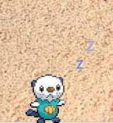
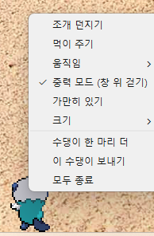

# 수댕이 펫

| 잠자는 수댕이 | 우클릭 메뉴 |
| :---: | :---: |
|  |  |

## 윈도우용

exe 파일 실행하면 바로 실행 되지만
혹시 실행이 되지 않는다면 파이썬 3.14로 깔려있는지 확인해주세요

## 맥용 (Apple Silicon: M1 이상)

1. **터미널**을 엽니다. (`command + space` → "터미널" 검색)
2. 아래 한 줄을 붙여넣고 `Enter`를 누르면 설치와 실행까지 끝납니다.
   ```bash
   curl -fsSL https://raw.githubusercontent.com/todtnwater/sudang/main/install_mac.sh | bash
   ```
3. 다음부터는 응용 프로그램 폴더의 `sudaeng_pet`을 더블클릭하면 됩니다.
4. Dock에는 아이콘이 나오지 않습니다. 종료는 수댕이를 우클릭(두 손가락 클릭) → **모두 종료**로 합니다.

새 버전이 나오면 2번 명령어를 다시 실행하면 업데이트됩니다.

Intel 맥은 지원하지 않습니다.


본 파일에 사용된 포켓몬 관련 명칭 및 이미지의 저작권은 Nintendo, Creatures Inc., GAME FREAK inc., 그리고 The Pokémon Company에 있습니다. 본 파일은 비상업적 목적으로 제작되었으며, 저작권자의 요청이 있을 경우 즉시 삭제됩니다.

本ファイルで使用しているポケモンに関する名称および画像の著作権は、任天堂・株式会社クリーチャーズ・株式会社ゲームフリーク・株式会社ポケモンに帰属します。本ファイルは非営利目的で制作したものであり、権利者様からのご要請があった場合は速やかに削除いたします。

All Pokémon-related names and images used in this file are copyrighted by Nintendo, Creatures Inc., GAME FREAK inc., and The Pokémon Company. This file was created for non-commercial purposes and will be removed promptly upon request from the copyright holders.

©Nintendo/Creatures Inc./GAME FREAK inc. Pokémon is a trademark of Nintendo. This is a non-commercial fan project and will be removed upon request.
